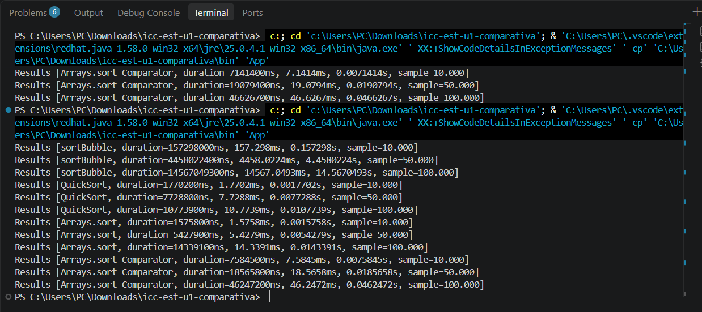

# PRÁCTICA DE COMPARATIVA DE MÉTODOS DE ORDENAMIENTO Y BENCHMARKING

## Capturas

## Tabla de Datos Obtenidos
| Método | Sample | Tiempo en milisegundos |
| :--- | :---: | :---: |
| Bubble Sort (sortBubble) | 10 000 | 157.298 ms |
| Quick Sort (QuickSort) | 10 000 | 1.7702 ms |
| Arrays.sort · int[] | 10 000 | 1.5758 ms |
| Arrays.sort + Comparator · Integer[] | 10 000 | 7.5845 ms |
| Bubble Sort (sortBubble) | 50 000 | 4458.0224 ms |
| Quick Sort (QuickSort) | 50 000 | 7.7288 ms |
| Arrays.sort · int[] | 50 000 | 5.4279 ms |
| Arrays.sort + Comparator · Integer[] | 50 000 | 18.5658 ms |
| Bubble Sort (sortBubble) | 100 000 | 14567.0493 ms |
| Quick Sort (QuickSort) | 100 000 | 10.7739 ms |
| Arrays.sort · int[] | 100 000 | 14.3391 ms |
| Arrays.sort + Comparator · Integer[] | 100 000 | 46.2472 ms |

## Análisis Requerido

1. **¿Cómo cambia el tiempo de cada método al aumentar el tamaño de la muestra?**

En sortBubble el aumento de tiempo es brusco: con 10 000 datos tardó 157.298 m`, al subir a 50 000 saltó a 4458.0224 ms (unas 28 veces más) y con 100 000 llegó a 14567.0493 ms (más de 92 veces el tiempo inicial). Eso refleja su crecimiento cuadrático O(n^2).

En los otros tres métodos el crecimiento fue mucho más controlado. QuickSort pasó de 1.7702 ms (10 000) a 7.7288 ms (50 000) y a 10.7739 ms (100 000). Arrays.sort sobre int[] subió de 1.5758 ms a 5.4279 ms y terminó en 14.3391 ms. Por su parte, Arrays.sort con Comparator sobre Integer[] creció de 7.5845 ms a 18.5658 ms y llegó a 46.2472 ms en 100 000 elementos.

2. **¿Qué método obtuvo el menor tiempo para cada tamaño en las ejecuciones realizadas?**

* **10 000 elementos:** Arrays.sort (int[]) con 1.5758 ms.
   
* **50 000 elementos:** Arrays.sort (int[]) con 5.4279 ms.
   
* **100 000 elementos:** QuickSort con 10.7739 ms (superando por poco a Arrays.sort, que registró 14.3391 ms).

3. **¿Por qué cada ordenamiento debe recibir un clon nuevo de la muestra original?**

Porque los cuatro métodos ordenan modificando el arreglo directamente en memoria (in-place). Si se reutilizara el mismo arreglo, a partir de la segunda variante el algoritmo recibiría los datos ya ordenados y no estaría resolviendo el mismo problema. En el caso de sortBubble, la bandera de corte haría que termine en una sola pasada, mientras que QuickSort con pivote al final caería justo en su peor caso O(n²) al recibir un arreglo ya ordenado. Usar clones garantiza que todas las variantes trabajen exactamente con los mismos valores y el mismo desorden inicial.

4. **¿Qué diferencias deben considerarse al comparar int[] con Integer[] y Comparator, aun excluyendo la conversión del cronómetro?**

Aunque la conversión de int[] a Integer[] se realiza fuera del cronómetro, siguen existiendo diferencias de fondo durante el ordenamiento. Primero, int[] guarda los valores primitivos seguidos en memoria, mientras que Integer[] guarda referencias a objetos en el heap, lo que implica más accesos indirectos en memoria y peor uso de la caché, además de invocar al Comparator en cada comparación. Segundo, Arrays.sort sobre int[] usa Dual-Pivot Quicksort, mientras que la sobrecarga con Comparator sobre Integer[] utiliza TimSort, un algoritmo estable que reserva memoria auxiliar. Por eso la diferencia en 100 000 elementos (14.3391 ms frente a 46.2472 ms) corresponde a toda esa combinación y no se puede atribuir únicamente al comparador.

5. **¿Qué operaciones quedaron incluidas en el tiempo y cuáles fuera? ¿Qué limitaciones tiene comparar una sola ejecución por método y tamaño?**

Dentro del intervalo medido solo quedó la llamada al ordenamiento y el trabajo interno que cada algoritmo necesita para completarlo, como comparaciones, intercambios, llamadas recursivas o arreglos auxiliares internos en el caso de TimSort. Quedaron fuera la generación de las muestras, la clonación de los arreglos, la conversión a Integer[], la creación del comparador, la validación del resultado y la impresión final en consola. La principal limitación de hacer una sola ejecución por método y tamaño es que un tiempo puntual puede verse afectado por factores ajenos al algoritmo, como procesos en segundo plano del sistema operativo, pausas del recolector de basura o el calentamiento del compilador JIT de Java. En esta corrida, por ejemplo, Arrays.sort fue más rápido en 10 000 y 50 000 elementos, pero QuickSort obtuvo un tiempo menor en 100 000; con una sola medición se pueden ver tendencias claras, pero no afirmar que un método será siempre más rápido que otro.

## Conclusiones :D

1. Al ver los tiempos con 100 000 elementos entre sortBubble (14567.0493 ms) y QuickSort (10.7739 ms), queda claro que un algoritmo cuadrático deja de ser práctico cuando los datos crecen. Aunque sortBubble incluye la bandera para cortar si no hubo intercambios, con entradas aleatorias esa condición casi nunca se cumple temprano y termina tardando más de 14 segundos frente a los 10 ms de dividir el arreglo con pivotes.

2. En la muestra de 100 000 elementos, Arrays.sort sobre int[] tardó 14.3391 ms mientras que Arrays.sort con Comparator sobre Integer[] tardó 46.2472 ms (más del triple), incluso dejando la conversión a Integer[] fuera del cronómetro. Esto muestra que elegir tipos objeto en lugar de primitivos y usar una sobrecarga basada en TimSort con comparador tiene un costo real durante el ordenamiento.

3. El cambio en el primer lugar según el tamaño Arrays.sort fue el menor en 10 000 (1.5758 ms) y 50 000 (5.4279 ms), mientras que QuickSort registró el menor en 100 000 (10.7739 ms) deja en evidencia que hacer una sola ejecución por prueba sin calentamiento previo de la JVM introduce variaciones pequeñas. Por lo tanto, estos resultados muestran la ventaja clara de los algoritmos O(n log n) frente a O(n^2), pero no permiten asegurar que QuickSort vaya a ganar siempre a Arrays.sort, menos aún si llegara una entrada ya ordenada donde la partición de Lomuto se degradaría.